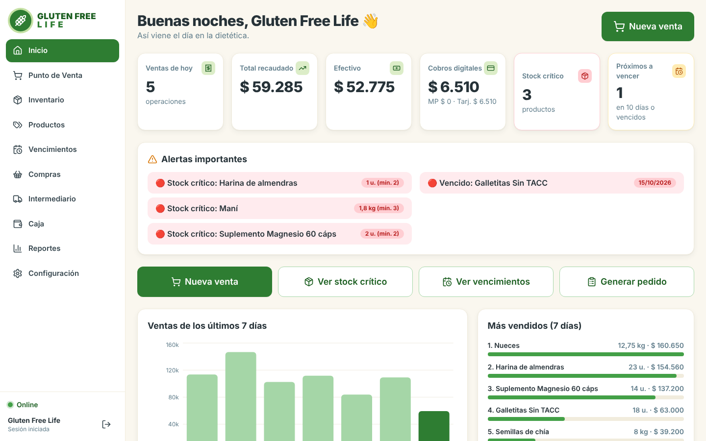
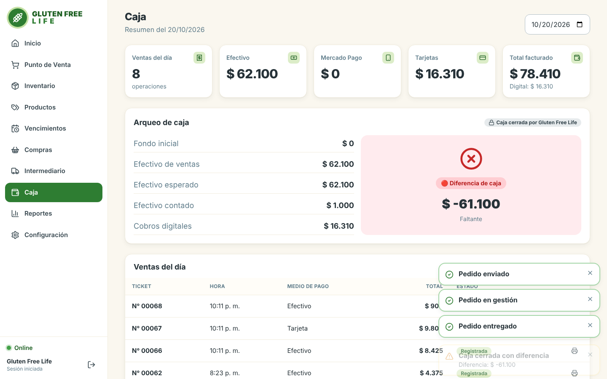
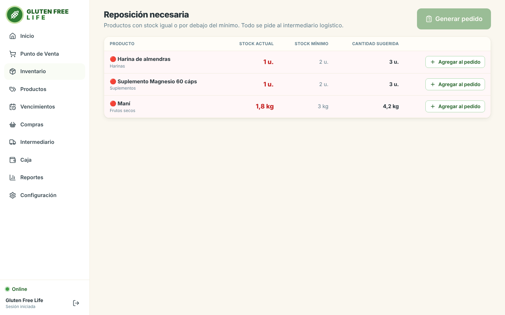
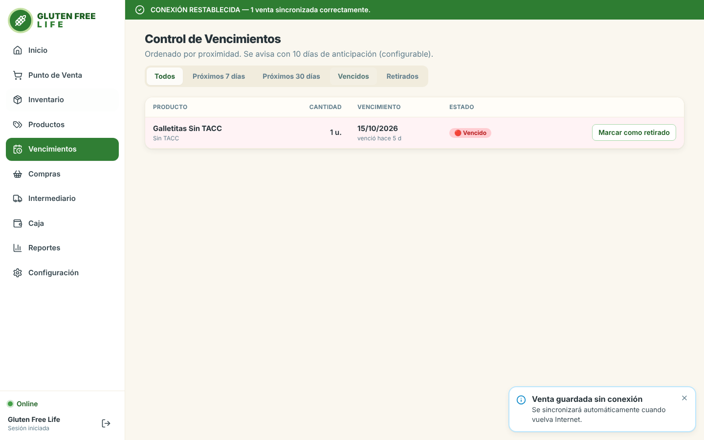
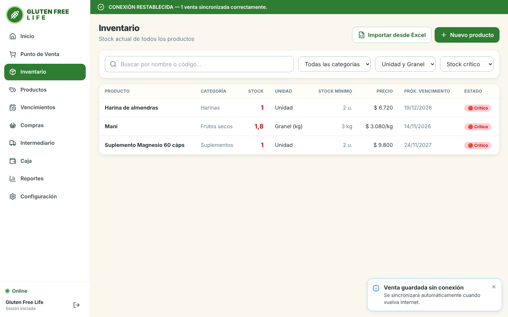
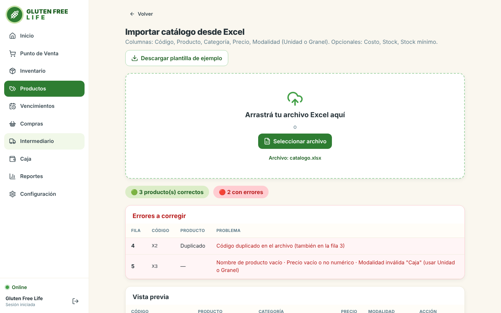
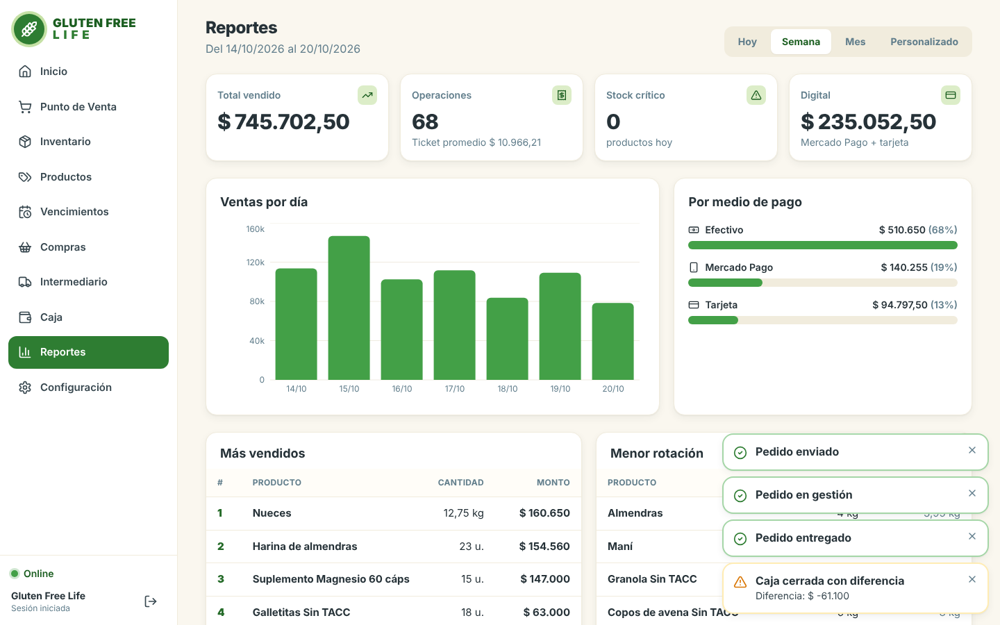
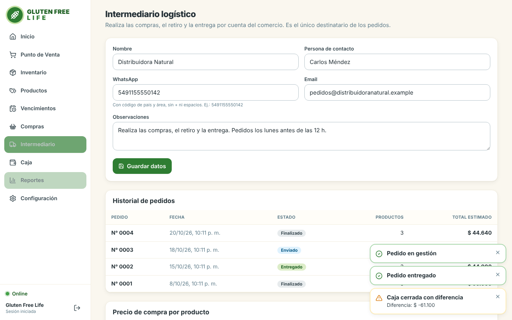

# 🌾 Gluten-Free Life - Sistema de Gestión y Punto de Venta (POS)

**Gluten-Free Life** es un sistema integral de Punto de Venta (POS) y gestión empresarial (ERP ligero) diseñado específicamente para optimizar las operaciones de comercios, garantizando un control riguroso de inventarios, vencimientos y transacciones financieras.

Este repositorio corresponde a la entrega de **Proyecto Final**, demostrando la implementación de una arquitectura _full-stack_ robusta, validación de datos, sincronización y despliegue en contenedores.

## 🚀 Características Principales

**Punto de Venta (POS) Ágil**: Interfaz optimizada para el registro rápido de ventas y generación automática de tickets.

**Gestión de Inventario Avanzada**: Control de stock en tiempo real, ABM de productos y categorización.

**Alertas Inteligentes**: Módulos dedicados para monitorear _Stock Crítico_ y productos próximos a _Vencimientos_ (vital para el rubro alimenticio).

**Control de Caja**: Apertura, cierre y arqueo de caja con un historial detallado de movimientos.

**Dashboard y Analítica**: Panel principal con métricas clave y módulo de reportes para la toma de decisiones.

**Importación y Exportación masiva**: Carga rápida de catálogos mediante archivos Excel (.xlsx) con validación de inconsistencias en el backend.

**Resiliencia Offline**: Sincronización local y manejo de estado para operar ante cortes de conexión.

## 🛠️ Stack Tecnológico

El proyecto fue desarrollado utilizando tecnologías modernas para garantizar escalabilidad, rendimiento y una excelente experiencia de usuario (UX):

### Frontend

- **React + TypeScript** — interfaz de usuario tipada.
- **Vite** — herramienta de desarrollo y compilación.
- **Tailwind CSS** — estilos y componentes de interfaz.

### Backend

- **Node.js + TypeScript** — entorno y lenguaje del servidor.
- **Base de datos SQL** — esquema gestionado mediante migraciones.
- **Arquitectura por servicios** — lógica de negocio organizada en `src/services/`.

### DevOps y herramientas

- **Docker y Docker Compose** — contenedorización de la aplicación.
- **Git** — control de versiones.

## 📸 Vistas del Sistema

A continuación se presentan algunas pantallas clave del sistema operativo:

### Panel de Control (Dashboard)

Brinda un resumen rápido de las ventas y el estado del negocio.


### Control de Caja

Módulo para controlar el flujo de dinero, apertura y cierre de jornada.


### Alertas de Inventario

El sistema notifica automáticamente los productos con bajo stock o cercanos a su fecha de vencimiento.




### Importación de Datos y Validación

El sistema detecta y notifica errores en los archivos de carga masiva antes de corromper la base de datos.


### Reportes y Proveedores

Módulos de analítica profunda y gestión de terceros.



## ⚙️ Puesta en Marcha (Instalación)

El proyecto está dockerizado.

### Requisitos Previos

- [Docker](https://www.docker.com/) y Docker Compose instalados.
- Git.

### Pasos para ejecutar con Docker (Recomendado)

1. **Clonar el repositorio:**

   ```bash
   git clone <URL_DEL_REPOSITORIO>
   cd gluten-free-life
   ```

2. **Levantar los contenedores:**
   Ejecuta el siguiente comando en la raíz del proyecto para construir las imágenes y levantar la base de datos, el backend y el frontend:

   ```bash
   cp .env.example .env        # Cambiar POSTGRES_PASSWORD y JWT_SECRET según corresponda
   docker compose up -d --build
   ```

3. **Acceder a la Aplicación:**
   - Frontend: Abre tu navegador en `http://localhost:4000` (o el puerto expuesto).
   - Inicia sesión con las credenciales configuradas para la aplicación. En el primer arranque se aplican las migraciones y se cargan datos de demostración (solo si la base está vacía).

## Desarrollo local (sin Docker)

Requiere Node 22 y PostgreSQL 16.

```bash
# 1) Base de datos
createdb gfl

# 2) Backend  (http://localhost:4000)
cd backend
cp .env.example .env        # ajustá DATABASE_URL
npm install
npm run migrate
npm run seed                # carga la demostración (BORRA los datos de negocio)
npm run dev

# 3) Frontend (http://localhost:5173), en otra terminal
cd frontend
npm install
npm run dev
```

En producción sin Docker: `npm run build` en ambas carpetas y `npm start` en `backend/`. El backend sirve el frontend compilado si existe `frontend/dist`.

### Guía de Pruebas Rápida

Para evaluar el alcance del proyecto, te sugerimos seguir este flujo:

1. Ingresa al sistema e inicia la jornada abriendo la **Caja**.
2. Dirígete a **Importar** y sube el archivo `docs/ejemplo-catalogo-con-errores.xlsx` para ver cómo el backend rechaza y notifica datos corruptos.
3. Ve al **POS**, realiza una venta de prueba y genera el **Ticket**.
4. Revisa el **Dashboard** y el panel de **Inventario** para comprobar el descuento automático del stock.

## Cómo demostrar el modo offline

1. Ingresá y abrí **Configuración → Simular pérdida de conexión**.
2. Andá al **Punto de Venta** y hacé una venta: se guarda en el equipo (ticket `OFF-0001`).
3. Volvé a **Configuración → Restablecer conexión**: la venta se sincroniza sola y aparece «CONEXIÓN RESTABLECIDA».

Sin conexión, el resto de las pantallas queda en **solo lectura** con los datos guardados. Pedidos, ingresos, cierre de caja e importación requieren conexión y lo avisan. El catálogo se guarda en el navegador (IndexedDB) cuando se ingresa con conexión; la primera vez hace falta Internet para iniciar sesión.

## 📂 Estructura del Proyecto

```text
gluten-free-life/
├── frontend/             # SPA en React/Vite
│   ├── src/
│   │   ├── components/   # Componentes UI reutilizables
│   │   ├── pages/        # Vistas de la aplicación (POS, Caja, Dashboard, etc.)
│   │   ├── lib/          # Lógica de negocio
│   │   └── store/        # Manejo del estado global
├── backend/              # API RESTful en Node.js
│   ├── src/
│   │   ├── services/     # Lógica central
│   │   ├── routes.ts     # Definición de endpoints
│   │   └── db.ts         # Conexión a BD
│   └── migrations/       # Scripts SQL
├── docs/                 # Documentación, excels de prueba y capturas
└── docker-compose.yml    # Orquestación del despliegue
```

## 👨‍🎓👩‍🎓 Equipo

| [<br><sub>Ailén Páez</sub><br><sub>a.jorgelinapaez@gmail.com</sub>](https://github.com/ailenpaez) | [<br><sub>Marcela Herrera</sub><br><sub>mfh.jea1814@gmail.com</sub>](https://github.com/HerreraMarcela) | [<br><sub>Neyel Vilaseco</sub><br><sub>neyelvilaseco@gmail.com</sub>](https://github.com/NeyelVila) | [<br><sub>Sebastián Matías Puche</sub><br><sub>sebasterco10@gmail.com</sub>](https://github.com/SebasTerco73) |

## Licencia

Proyecto con fines educativos (Practica profesionalizante IV: PROYETO INTEGRADOR). Repositorio: //**poner repositorio**
**Año:** 2026

_Agradecimientos especiales a los profesores y mentores que acompañaron el proceso de desarrollo de este proyecto._

```

```
